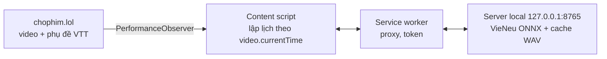

# VoxSync: lồng tiếng Việt khi xem phim trên Chrome

VoxSync đọc phụ đề tiếng Việt của phim đang xem trên **chophim.lol** bằng [VieNeu-TTS](https://github.com/pnnbao97/VieNeu-TTS) chạy ngay trên máy của bạn, và phát lời thoại khớp với hình. Video gốc không bị tải về hay chỉnh sửa, và không cần dịch vụ cloud.



## Yêu cầu
- macOS Apple Silicon (đã đo trên M5 Max), Chrome ≥ 120
- [`uv`](https://docs.astral.sh/uv/), `ffmpeg` (`brew install uv ffmpeg`), Node ≥ 20 (chỉ để build extension)

## Cài đặt (khoảng 10 phút, chưa tính thời gian tải model)
1. **Server**
   ```bash
   cd server && uv sync
   ./scripts/voxsync-server          # lần đầu tải ~610 MB model, sau đó chạy offline
   ```
   Tuỳ chọn: chạy `./scripts/install-launchagent` để server tự khởi động khi đăng nhập (log ở `~/.voxsync/server.log`).
2. **Extension**
   ```bash
   cd extension && npm install && npm run build
   ```
   Vào `chrome://extensions`, bật **Developer mode**, chọn **Load unpacked** rồi trỏ tới thư mục `extension/dist`.
3. **Kết nối:** mở trang cài đặt của extension (popup → "Quản lý giọng & cài đặt"), dán token, bấm **Lưu & kiểm tra**. Token lấy bằng:
   ```bash
   cat ~/.voxsync/token
   ```

## Sử dụng
1. Mở phim trên chophim.lol, chọn server **Song Ngữ** (server có phụ đề tách rời).
2. Click một lần vào trang (ví dụ vào tiêu đề phim) để Chrome cho phép phát âm thanh. Quảng cáo đầu phim chạy xong thì lời thoại tiếng Việt sẽ phát, đồng thời âm gốc tự giảm khi có thoại.
3. **Popup** cho phép:
   - bật/tắt lồng tiếng;
   - chọn **cách lồng tiếng** (xem bên dưới) và giọng mặc định cho từng phim;
   - xem danh sách **nhân vật** đã nhận ra, mỗi nhân vật kèm một câu thoại mẫu; đổi giọng từng nhân vật (áp dụng cho cả bộ phim, kể cả các tập sau);
   - chỉnh âm lượng tiếng lồng và mức giảm âm gốc;
   - chỉnh lệch đồng bộ ±500 ms (khi dùng tai nghe Bluetooth);
   - bật chặn quảng cáo (mặc định tắt);
   - nạp phụ đề thủ công bằng URL hoặc file `.vtt`/`.srt`.
4. **Trang cài đặt:** quản lý 25 giọng có sẵn, gồm lọc theo giới tính/vùng miền, nghe thử, đặt giọng mặc định. Có thể nhân bản giọng từ clip 3–15 giây hoặc ghi âm từ micro; chỉ nhân bản giọng mà bạn có quyền sử dụng.

### Cách lồng tiếng
| Chế độ | Cách hoạt động |
|---|---|
| **Mỗi nhân vật một giọng** (mặc định) | Server nghe âm thanh gốc của từng câu (từ luồng phim của server KK cùng tập), nhận ra người nói và giới tính. 4 nhân vật nói nhiều nhất có giọng riêng; người khác dùng chung một giọng nam hoặc một giọng nữ. |
| **Giọng diễn viên (clone)** | Như trên, nhưng mỗi nhân vật được nhân bản giọng từ 3 câu thoại gốc đầu tiên của họ. Phải xác nhận **chỉ dùng cá nhân**. |
| **Một giọng cho cả phim** | Như bản 0.1. |

Cảm xúc: các mô tả âm thanh trong phụ đề như `[cười khẩy]`, `[thở dài]`, `[hắng giọng]` đi kèm lời thoại được đọc bằng thẻ cảm xúc của VieNeu. Câu chỉ có mô tả âm thanh thì không lồng, vì tiếng gốc đã có.

Lần đầu khởi động, server tải thêm 2 model khoảng 400 MB (trước khi mở cổng, giống model TTS): nhận diện người nói (ERes2Net) và giới tính (audeering wav2vec2, giấy phép CC BY-NC-SA, chỉ dùng phi thương mại).

## Số đo (M5 Max, chi tiết trong `docs/`)
| | |
|---|---|
| Backend | ONNX Runtime CPU fp32, RTF ≈ 0,11; chế độ nhân vật dùng thêm khoảng 1,9 GB RAM (model giới tính). MPS chậm khoảng 2×, CoreML khoảng 2,2× (`docs/00-feasibility.md`) |
| Sinh cả tập 48 phút | khoảng 3,5 phút; cache ≈ 346 MB mỗi giờ lời thoại |
| Lệch hình–tiếng (loa trong) | trung bình −2,9 ms, p95 36 ms (`docs/02-browser-integration.md`) |
| Tua/seek tới đoạn chưa sinh | có tiếng sau ≤ 0,7 s |
| Server khởi động lại | lồng tiếng tự nối lại sau khoảng 2,5 s |

## Giới hạn đã biết
- Hiện chỉ hỗ trợ chophim.lol. Server "Vietsub (KK)" và "Thuyết Minh (KK)" in phụ đề vào hình nên không lồng tiếng được; hãy dùng phụ đề thủ công nếu có file.
- Nhận diện nhân vật dựa trên giọng, nên chưa hoàn hảo. Cảnh 2 người ở tập 1 đúng 20/22 câu, không câu nào sai giới tính. Vai phụ ít lời có thể bị gộp hoặc tách nhầm; đổi giọng trong popup nếu cần. Phim không có server KK (luồng `.m3u8` trực tiếp) thì quay về một giọng, và popup báo lý do.
- Câu thoại phát ở tốc độ 1× cả khi video chạy 1,25× hoặc 1,5×: đầu câu vẫn khớp hình nhưng câu sẽ kết thúc muộn hơn.
- Tai nghe Bluetooth có độ trễ riêng: tự động bù theo `outputLatency`, phần còn lệch thì chỉnh bằng thanh "Lệch đồng bộ".
- Chặn quảng cáo có thể trái điều khoản của chophim; tính năng này tắt mặc định.

## Phát triển
```bash
cd server && uv run --group dev pytest -q           # 61 test
cd extension && npm test && npx tsc --noEmit        # 49 test
```
Kế hoạch và các quyết định thiết kế nằm trong `plans/`, số đo và bằng chứng nằm trong `docs/`.
