# 00 — Báo cáo khả thi Phase 0: VieNeu Live Dubbing

Ngày: 2026-11-11 · Máy: Apple M5 Max (6 P-core + 12 E-core), 128 GB, macOS 27.0.1 · Chrome stable.

Ký hiệu: **[V]** = đã kiểm chứng (đo, đọc source, hoặc quan sát trực tiếp) · **[I]** = suy luận, cần thực nghiệm.

---

## 1. Kết luận

**GO, với một mục còn mở.** Kết quả gating G1–G3 (§6.1, chạy ngày 2026-11-11):

- **G1 đồng bộ:** pass với loa trong.
- **G3 tua (seek):** pass.
- **G2 chất lượng:** pass theo chỉ số khách quan (ASR). Lựa chọn int8 vẫn cần người nghe ABX.

Mục còn mở: chưa đo AirPods/Bluetooth. Mục này không chặn Phase 1, vì phương án dự phòng (bù trễ theo thiết bị + slider offset) đã có sẵn.

| Câu hỏi | Kết luận ngắn |
|---|---|
| Q1. Backend nào nhanh nhất trên M5 Max | **ONNX Runtime CPU** (đường mặc định của SDK), `threads=4–6`. MPS chậm hơn khoảng 2×, CoreML EP chậm hơn khoảng 2,2×, chưa có bản MLX. |
| Q2. Giữ audio khớp video | Lấy `video.currentTime` làm đồng hồ chuẩn. Lập lịch `AudioBufferSourceNode.start(when)` trên AudioContext; khi gặp `seeking`/`waiting`/`pause`/`ratechange`/`emptied` thì hủy và lập lịch lại. Không dùng `setTimeout` để phát. |
| Q3. Điều khiển video/âm lượng qua iframe | Trên trang đích lúc chạy **không có iframe**: `<video>` nằm ở top frame. Ghi `volume`/`playbackRate` được và player không ghi đè. Nếu gặp iframe cross-origin (`player.phimapi.com`, JW Player) thì vẫn làm được bằng `all_frames`, nhưng user activation và localhost phải đi đường khác (§4). |

---

## 2. VieNeu-TTS: các điểm đã xác minh

Nguồn: `github.com/pnnbao97/VieNeu-TTS`, commit `22dd2ef` (2026-11-09), package `vieneu 3.8.4`, release app `app-v0.18.24`.

| Hạng mục | Kết quả |
|---|---|
| License | Apache-2.0 [V]. Quyền thương mại với audio sinh ra vẫn đang hỏi ở issue #218 (open). Dự án cá nhân, local thì không bị ảnh hưởng. |
| Model mặc định | **v3 Turbo**, 48 kHz, repo HF `pnnbao-ump/VieNeu-TTS-v3-Turbo` [V] (`config.yaml`) |
| Backend có sẵn | `backend="onnx"` (CPUExecutionProvider cố định trong `onnx_runtime_lite.py:157`), `backend="pytorch"` (device `cuda`/`cpu`/`mps`) [V] |
| macOS | Hỗ trợ qua `uv sync`, bản minimal không cần torch [V] (README) |
| Giọng | Preset trong `assets/voices_v3_turbo.json` (speaker_emb 192-d + codes). Có voice cloning từ clip 3–5 s [V] |
| Streaming | Có `infer_stream()`. `config.yaml` ghi `supports_streaming: false` cho UI, còn SDK vẫn có hàm này [V] |
| API | Có sẵn `apps/openai_speech.py` (`POST /v1/audio/speech`, tương thích OpenAI) [V] |
| Giới hạn text | `max_chars_per_chunk: 256` [V] |
| Bug gặp phải | ORT 1.31 không chịu load external data (`*.data`) qua symlink trong HF cache khi dùng `precision="int8"`. **Workaround:** `snapshot_download(local_dir=...)` rồi truyền `onnx_dir=` [V] |
| Đề xuất upstream liên quan | PR #181 "configurable ONNX Runtime providers" (open) [V] |

---

## 3. Q1: Benchmark backend (đo thực, không trích README)

Script: `benchmarks/phase0/bench.py`. Mỗi ô là median của N=5 lần (MPS/CoreML N=3), đã warm-up, `apply_watermark=False`.
Văn bản: 10 ký tự "Tôi là ai?", 50 ký tự, 150 ký tự (lấy từ VTT tập 1).
RTF = thời gian sinh ÷ độ dài audio. RTF càng nhỏ càng nhanh.

| Backend | Load (s) | RTF 10/50/150 ký tự | Latency câu 150 ký tự | RSS đỉnh |
|---|---|---|---|---|
| **ORT CPU fp32, threads=6** | 5,5 | **0,12 / 0,11 / 0,12** | **0,85 s** | 2,4 GB |
| ORT CPU fp32, threads=4 | 5,4 | 0,12 / 0,11 / 0,12 | 0,86 s | 2,4 GB |
| ORT CPU fp32, threads=12 | 5,5 | 0,13 / 0,12 / 0,13 | 0,90 s | 2,1 GB |
| ORT CPU **int8**, threads=6 (`onnx_dir`) | 3,1 | 0,10 / 0,09 / 0,10 | 0,71 s | 1,8 GB |
| ORT **CoreML EP** (MLProgram, CPUAndGPU, static shapes) | 9,2 | 0,26 / 0,26 / 0,27 | 1,85 s | 2,3 GB |
| PyTorch **MPS** | 37,9 | 0,27 / 0,23 / 0,23 | 1,70 s | 1,7 GB |
| PyTorch CPU | 6,2 | 0,19 / 0,19 / 0,18 | 1,30 s | 1,4 GB |
| MLX | — | không có bản port (đã tìm trong repo, issue và web) | — | — |

Ghi chú [V]:
- **CoreML EP:** cấu hình `ALL`/`MLProgram` lỗi khi build model (`error code -7`). Cấu hình `NeuralNetwork` lỗi vì input KV cache có shape động. Chỉ chạy được khi bật `RequireStaticInputShapes`: khi đó 1384/1637 node vào CoreML, chia thành 61 partition, phần KV động chạy trên CPU. Chi phí chuyển qua lại giữa các partition khiến nó chậm hơn CPU thuần. **Loại.**
- **MPS:** quá trình decode tự hồi quy chạy từng frame nhỏ nên bị giới hạn bởi chi phí launch kernel. GPU không có lợi; cùng hiện tượng README mô tả với GPU ở câu ngắn. **Loại** cho đường realtime.
- **Số thread:** từ 4 đến 12 thread gần như không khác nhau, vì decode bị giới hạn bởi latency chứ không bởi lượng tính toán. Chọn 4–6 thread để chừa E-core cho Chrome.
- **Chạy đồng thời:** 2 process ORT (mỗi process 4 thread) chạy song song, mỗi process đạt RTF khoảng 0,13, tổng throughput khoảng **1,9×** [V]. Trong một process, engine có `RLock` nên các lời gọi bị tuần tự hóa [V source].
- **int8:** nhanh hơn khoảng 20%. README cảnh báo méo tiếng trên CPU x86 thiếu VNNI. Apple Silicon có `FEAT_I8MM`/`FEAT_DotProd`/`FEAT_BF16` = 1 [V], **nhưng chưa nghe thử chất lượng** [I]. Mẫu đã lưu ở `/tmp/vnbench/onnx_int8_t6.wav` và `onnx_fp32_default.wav` (file tạm, không commit).

**Áp vào phim thật [V]:** tổng hợp 200 cue đầu của tập 1 (VTT tiếng Việt có 716 cue, dài 48,5 phút) mất 46,7 s cho 437 s audio, **RTF 0,107**, tức nhanh hơn thời gian thực khoảng 9×. Lookahead 60 s chỉ cần khoảng 7 s tính toán. Pre-generation vì vậy luôn chạy trước playback với biên rộng, và **streaming TTS không mang lại lợi ích cho MVP** (ADR-005: chọn pre-generation; ADR-003: dùng HTTP thay vì WebSocket).

**Quyết định ADR-002 (provisional cho tới khi nghe thử int8):** ORT CPU fp32, `threads=6`, 1 process. int8 chỉ bật sau khi qua bài nghe A/B.

---

## 4. Q3: Cấu trúc trang đích và quyền điều khiển của extension

### 4.1 Quan sát runtime [V] (Chromium headless + CDP)
Xem chi tiết đầy đủ ở phụ lục A.
- Không có iframe trên cả hai server "Song Ngữ" và "Vietsub (KK)".
- Có đúng một `<video>` ở top frame `https://chophim.lol`, không nằm trong shadow DOM. Nguồn là `src=blob:` (MSE).
- Player là React component tự viết, không lộ global nào. Phụ đề do React vẽ thành DOM overlay; `textTracks` = 0.
- VTT được tải bằng `fetch` từ `/api/storage/subtitles?file=<slug>-tap-N-<timestamp>-<hash>-tap_NN_vietnamese.vtt`. Tên file không đoán trước được. Response trả `access-control-allow-origin: *` [V curl].
- Ghi `video.volume = 0.3` và `playbackRate = 1.25` từ JS trang: giá trị được giữ, player không ghi đè.
- Seek: `seeking` + `waiting` → `seeked` sau 19 ms → `playing`.
- Pre-roll quảng cáo 62 s phát **trên cùng `<video>`**, sau đó là `ended` → `emptied` → đổi `src`.
- Đổi tập: vẫn cùng element; `src` đổi kèm `emptied` → `loadedmetadata`, và có request VTT mới. Hash URL chỉ phản ánh state của app, sửa hash không điều khiển được player.
- Server "Vietsub (KK)": không có VTT. Khả năng là hardsub [I], nên **không lồng tiếng được** trên server này.

### 4.2 Mâu thuẫn cần ghi nhận
HTML SSR có các trường `link_embed` trỏ tới `player.phimapi.com/player/?url=…m3u8` (JW Player 8.38.3 + hls.js, cross-origin, không có `sandbox`/`allow`) [V curl], nhưng không thấy chúng được render trong các server đã thử [V CDP]. Iframe này có thể xuất hiện ở phim hoặc server khác, nên kiến trúc phải có **player adapter** cho cả hai trường hợp.

### 4.3 Năng lực MV3 (nguồn chính thức; chi tiết ở phụ lục B)
| Năng lực | Top frame (chophim) | Iframe cross-origin (JW) |
|---|---|---|
| Content script chạy được | Có [V doc] | Có, với `all_frames: true` + match host [V doc] |
| Đọc/ghi `currentTime`, `volume`, `playbackRate` và nghe event media | Có [V quan sát] | Có [V doc]; JW có thể reset volume khi đổi item [I] |
| Gọi API player | Không cần | `world: "MAIN"` → `jwplayer()` [V doc] |
| AudioContext được resume | Có, nhờ activation từ click Play hoặc Skip-ad của user trong top frame [I] | Cần activation **trong chính iframe** [I], là **rủi ro gating** |
| Fetch tới `http://127.0.0.1` từ content script | Chịu CORS của trang và Local Network Access (Chrome 142+) [V] | Bị chặn nếu thiếu `allow="loopback-network"` [V] |
| Fetch tới localhost từ service worker hoặc offscreen document | Có; LNA không áp dụng cho extension có host permission [V, LNA adoption guide] | Như cột bên trái |
| Giảm âm (ducking) | `video.volume = userVol × duck` [V] | Như cột bên trái, cộng `jwplayer().setVolume` nếu bị ghi đè |

Phương án đã loại:
- `createMediaElementSource`: element bị reroute hoàn toàn vào graph; context hỏng thì video câm; mỗi element chỉ tạo được một lần.
- `tabCapture`: cần click vào action của extension, tab bị mất tiếng và phải tự phát lại.

Cả hai đều xâm lấn hơn mức cần cho Smart Ducking.

**Đường gọi localhost (đã chốt):** service worker làm proxy, `host_permissions: ["http://127.0.0.1/*"]`. Content script chỉ gửi `{op, cueId, text, voice}`, không gửi URL tùy ý, để SW không thành open proxy. `chrome.runtime` serialize message bằng JSON, tối đa 64 MiB [V], nên audio trả về dạng base64: một cue 3 s WAV 48 kHz mono 16-bit khoảng 290 KB, base64 khoảng 380 KB, chấp nhận được. Opus là tối ưu cho Phase 4.
Không cho content script fetch thẳng tới localhost vì hai lý do:
- bị CORS của trang cộng LNA prompt gắn vào `chophim.lol`;
- để làm được thì server phải mở CORS cho origin của site, tức JS của site cũng gọi được TTS server.

**Bắt VTT (đã chốt):** VTT cùng origin `chophim.lol`. Content script dùng `PerformanceObserver({type: 'resource', buffered: true})`, lọc `/api/storage/subtitles?…_vietnamese.vtt`, rồi tự `fetch` lại URL đó (same-origin nên không vướng CORS). Cách này không cần `webRequest` hay hook MAIN world. Fallback: nhập URL hoặc file thủ công.

---

## 5. Q2: Đồng bộ audio

### 5.1 Đồng hồ
- **Chuẩn:** `video.currentTime`. Chromium neo giá trị này vào audio clock của chính media element [V web.dev rVFC].
- **Lập lịch:** khi chuyển từ media time sang context time, lấy cặp mẫu `(mediaT = video.currentTime, ctxT = audioCtx.currentTime)` tại cùng một thời điểm. Cue có thời điểm bắt đầu `cue.start` được phát bằng `src.start(ctxT + (cue.start − mediaT) / rate)`.
- Video và TTS ra cùng thiết bị output nên `outputLatency` của hai bên phần lớn triệt tiêu nhau. **[V, loa trong]:** phần dư hệ thống là dub **trễ khoảng +13–14 ms** (signed mean: sched +12,7 ms, rVFC +14,4 ms). Nguồn trễ là tổng của: tick quantization, pad `when = ctxT + 0,02` khi vào giữa câu, và `outputLatency` chưa được trừ khi `start(when)`. Phase 1 sẽ lập lịch tại `when − ctx.outputLatency − constBias`, đo lại trên loa trong tới khi signed mean ≈ 0, rồi mới đo AirPods. Đây cũng chính là núm chỉnh để bù trễ Bluetooth.
- **Không dùng `setTimeout` để phát.** Timer chỉ dùng cho tick lập lịch lookahead khoảng 250 ms. Ở tab nền, timer có thể bị gom về 1 Hz nếu tab không phát tiếng [V], nên mọi cue trong 2–3 s tới phải đã được `start(when)` sẵn.

### 5.2 Máy trạng thái

```mermaid
stateDiagram-v2
  [*] --> Idle
  Idle --> Armed: VTT loaded + video có duration phim
  Armed --> Playing: 'playing'
  Playing --> Stalled: 'waiting' / 'seeking'
  Playing --> Paused: 'pause'
  Playing --> Playing: tick 250ms, |drift|>80ms → resync
  Stalled --> Playing: 'playing' (hủy mọi source, lập lịch lại từ currentTime)
  Paused --> Playing: 'play'/'playing' (lập lịch lại; cue đang dở → offset vào buffer)
  Playing --> Idle: 'emptied' (đổi tập/quảng cáo) → xoá lịch, chờ VTT mới
  Playing --> Playing: 'ratechange' → lập lịch lại theo rate mới
```


| Sự kiện | Hành động |
|---|---|
| `pause` | `ctx.suspend()` cho phản hồi tức thì, hoặc `stop()` toàn bộ source và ghi lại vị trí |
| `play` / `playing` | Lập lịch lại từ `currentTime`. Cue đang phát dở dùng `start(when, offset)` |
| `seeking` | `stop()` mọi source, hạ ưu tiên queue sinh audio, đẩy ưu tiên các cue quanh vị trí mới |
| `waiting` (buffering) | Giống `pause`; `currentTime` đứng yên nên audio phải dừng theo |
| `ratechange` | Lập lịch lại; khoảng cách giữa các cue co giãn theo `rate`. **Không** đổi `AudioBufferSourceNode.playbackRate` vì làm lệch cao độ. Ở 1,25×/1,5×, tiếng tràn nhiều hơn, xử lý theo §5.3. Time-stretch theo rate để sang Phase 4 |
| `emptied` / `loadedmetadata` | Reset hoàn toàn; gắn VTT của tập mới bắt được ở network |
| Pre-roll quảng cáo | Chỉ **arm** khi `duration > 300 s` **và** request VTT xảy ra sau lần `emptied` gần nhất. Khi nút "Bỏ qua" đang hiện thì không lồng tiếng |

**Đo sai số đồng bộ:** trong harness local, log `ctx.getOutputTimestamp()` tại lúc một source bắt đầu và so với `video.currentTime` của rVFC tại cùng `performance.now()`. Sai số bằng `(mediaT_thực_khi_phát − cue.start)`. Kiểm thêm bằng mắt/tai: video test có beep tại các mốc cue.

### 5.3 Căn thời lượng (đo trên VTT thật, `benchmarks/phase0/fit.py`) [V]
| Chỉ số (200 cue đầu, giọng mặc định) | p50 | p90 | p99 |
|---|---|---|---|
| Độ dài tiếng ÷ độ dài cue | 0,90 | 1,30 | 1,59 |
| Độ dài tiếng ÷ khoảng tới cue kế tiếp | 0,64 | 1,12 | 1,59 |

- 30% cue có tiếng dài hơn thời lượng cue, nhưng **chỉ 6% cần tăng tốc quá 1,25×** và **1% cần quá 1,5×** để kịp trước cue kế tiếp.
- **Chính sách, tính lúc synth chứ không lúc phát.** VTT đã cho biết `next.start`, nên server tính `need = speechDur / (next.start − cue.start)`:
  - `need ≤ 1` → giữ nguyên;
  - `1 < need ≤ 1,25` → time-stretch giữ cao độ phía server (WSOLA, hoặc `atempo` của ffmpeg; chọn sau E2b);
  - `need > 1,25` → stretch 1,25× rồi cho tràn. Cue sau bị đẩy lùi tối đa 0,5 s; nếu vẫn chồng thì **bỏ cue sau** và log, **không cắt giữa câu**.
- VieNeu **không có tham số tốc độ native**: `apps/openai_speech.py:30` ghi `speed … ignored` [V]. Vì vậy cần time-stretch ngoài model.
- **Rủi ro chất lượng văn bản** [V, đếm trên 760 cue tập 1]:
  - 48 cue chứa `[SFX]` (vd. `[thở dài]`). Cần strip, vì v3 Turbo coi `[cười]` là tag cảm xúc.
  - 44 cue có hội thoại bắt đầu bằng `- `.
  - 249 cue có nhiều dòng.
  - 12 cue có chữ số.
  - 190 cue có tên riêng Latin (Stark, Edinburgh…).
  - Đã ghi nhận lỗi G2P upstream: #207 (`chánh` đọc thành `tránh`) và #199 (đọc sai tiền tố `đ/c`).

---

## 6. Thí nghiệm gating (bắt buộc trước Phase 1)

Ba thí nghiệm gating là **G1–G3**. Mỗi thí nghiệm là một spike vứt đi, không phải code sản phẩm. Kết quả xem §6.1. Thư mục `spikes/` đã được xoá ở bản 0.1.0; mã nguồn vẫn còn trong git ở commit `c470493`. Phép đo rVFC của G1 đã được đưa vào debug mode của extension.

| ID | Thí nghiệm | Pass khi | Nếu fail |
|---|---|---|---|
| **G1 — Sync spike E2E** | Extension unpacked trên chophim. Synth sẵn 20 cue WAV, serve bằng `python -m http.server` trên 127.0.0.1. SW proxy, content script lập lịch AudioContext theo `video.currentTime`. Bật `chrome://flags/#local-network-access-check` = Enabled (Blocking). Chạy các kịch bản: seek ±, pause, pre-roll, đổi tập, tab nền, loa trong và AirPods | `ctx.state === 'running'` sau click Play/Skip của user; SW fetch không bị LNA prompt; onset lệch p50 < 100 ms, p95 < 200 ms; không lồng tiếng lên quảng cáo; đổi tập không crash | Activation fail → offscreen document (`AUDIO_PLAYBACK`) + keepalive. SW fetch bị chặn → **No-Go** cho HTTP localhost, chuyển sang Native Messaging host. Sync > 200 ms → bù `outputLatency` riêng theo sink |
| **G2 — Chất lượng** | 30 cue thật: (a) ABX fp32 vs int8; (b) stretch 1,25×, so WSOLA với `atempo`; (c) tỷ lệ cue đọc sai do normalization | int8 không thua rõ; stretch 1,25× nghe tự nhiên; < 5% cue hỏng | int8 thua → giữ fp32. Stretch tệ → hạ trần xuống 1,15×. > 5% hỏng → thêm task normalizer (strip `[SFX]`, `- `, số, tên riêng) vào đầu Phase 1 |
| **G3 — Seek storm** | 10 seek liên tiếp, queue synth tuần tự + cache theo cue | Audio đầu tiên có ≤ 1,5 s sau seek; không stall quá 1 lần; RSS ổn định | Thêm process ORT thứ 2 (đã đo: throughput ≈ 1,9×), ưu tiên cue quanh vị trí seek |
| G4 (phụ) | Trang `player.phimapi.com` (JW, iframe) nếu xuất hiện: inject `all_frames`, đọc/ghi volume | Có `<video>`, volume không bị JW ghi đè | Adapter JW làm best-effort ở Phase 2 |

### 6.1 Kết quả (2026-11-11)

**Môi trường G1:**
- Chrome for Testing 150.0.7871.24 (Chromium headed), extension unpacked `spikes/g1-sync`, bật `--enable-features=LocalNetworkAccessChecks`.
- Âm thanh ra loa trong, `outputLatency` = 16 ms, `baseLatency` = 5,3 ms.
- Trang thật `chophim.lol`, tập 1 và tập 2. Cue sinh sẵn bằng ORT fp32 (`spikes/g1-sync/synth_cues.py`).

**Cách đo G1** (`spikes/g1-sync/analyze.py`, dump ở `docs/phase0-evidence/g1-dumps/`):
- Thước đo độc lập là `requestVideoFrameCallback`: so `mediaTime` của frame thực sự hiển thị (tại `expectedDisplayTime`) với mẫu lồng tiếng phát ra loa tại cùng thời điểm `performance.now()` (quy đổi qua `getOutputTimestamp`, đã tính `outputLatency`).
- Cách này không dựa vào clock mà scheduler dùng để lập lịch. Theo góp ý của review, cách đo đầu tiên (so với `video.currentTime`) bị thay thế vì scheduler tự chấm điểm chính mình.

| G1: chỉ số | Kết quả | Ngưỡng | |
|---|---|---|---|
| `ctx.state` sau một keydown thật của user trong trang | `running` | running | ✅ |
| SW fetch `http://127.0.0.1:8765` khi bật LNA checks | 200, không có prompt | không prompt | ✅ |
| Lệch hình–tiếng, đầu câu, rate 1 (1041 frame) | p50 31 ms · p95 41 ms · max 68 ms · trung bình +14 ms (dub trễ) | p50 < 100, p95 < 200 | ✅ |
| Lệch khi vào giữa câu (sau seek/resume, 184 frame) | p50 19 ms · p95 80 ms | p95 < 200 | ✅ |
| Lệch đầu câu ở 1,25× / 1,5× (37 frame) | p50 17 ms · p95 27 ms | p95 < 200 | ✅ |
| Drift giữa câu so với `currentTime` (201 mẫu) | p95 39 ms · 0 lần resync | < 80 ms | ✅ |
| Từ lúc seek tới khi nghe tiếng lồng (cue đã cache, đi hết SW→base64→decode→tick) | 225–237 ms (seek vào giữa câu); 0,9–2,8 s khi chưa có câu nào tới (khoảng lặng thật trong phim) | ≤ 1,5 s | ✅ |
| Quảng cáo pre-roll 62 s (cùng `<video>`) | 0 cue phát ra; arm sau `emptied` + VTT mới + `duration` 3201 s | 0 | ✅ |
| Đổi tập (click "Tập 02") | Nhận VTT `tap-2` (634 cue), arm lại, phát đúng cue tập 2, không rò audio tập 1 | không lỗi | ✅ |
| Tab nền 40 s (`visibilityState=hidden`) | Mẫu `currentTime` đều 50 ms, chỉ một khoảng hở 1,1 s; cue vẫn phát đúng lịch | không stall | ✅ |
| Ducking `video.volume` | 1 → 0,3 trong lúc thoại, về lại khi hết, ramp 5 bước. User đổi volume sang 0,6 thì sau đó duck về 0,18 (= 0,6 × 0,3); player không ghi đè | đúng | ✅ |
| AirPods / Bluetooth | **Chưa đo.** Máy chạy test không có tai nghe | — | ⏳ |

Lỗi spike tìm thấy và đã sửa trong lúc chạy:
- Duck bám theo cue đã lập lịch (sớm tới 3 s) thay vì cue đang phát thật. Sửa thành tick 50 ms + giữ 300 ms.
- `volumechange` được bắn bất đồng bộ nên cờ `selfVol` không có tác dụng. Sửa bằng cách so với giá trị extension ghi gần nhất.
- Race khi decode lúc đổi tập. Sửa bằng cách kiểm tra lại `ep` sau `await`.

Hai bài học vận hành cho Phase 2:
- `chrome.runtime.reload()` trên extension nạp bằng `--load-extension` làm extension bị gỡ hẳn.
- Click vào vùng `<video>` trên chophim có thể mở popup quảng cáo cờ bạc. Gesture nên lấy từ nút Play/Skip hoặc phím.

**G2 chất lượng** (`spikes/g2-quality/run.py`, 30 cue thiên về trường hợp khó: SFX, tên riêng, số, nhiều dòng):
- Proxy ASR: `mlx-whisper large-v3-turbo`, chấm CER.
- Cue "Ờ" (một âm tiết) bị loại khỏi bảng vì Whisper bịa nội dung (CER 1–69).
- Bộ ABX mù cho người nghe nằm ở `/tmp/vnbench/abx/` (`*_quant_A/B.wav`, khoá trong `abx_key.json`).

| Biến thể | CER trung bình | Số cue CER > 0,3 |
|---|---|---|
| fp32, text thô (chỉ gộp dòng) | 0,029 | 0/29 |
| fp32, có normalizer | **0,022** | 0/29 |
| int8, có normalizer | 0,032 | 0/29 |
| fp32 + WSOLA 1,25× (`audiotsm`) | 0,045 | 2/29 |
| fp32 + `ffmpeg atempo` 1,25× | 0,031 | 1/29 |

- **Normalization:** 0% cue hỏng, đạt ngưỡng < 5%. Normalizer thô (strip `[...]`, `(...)`, `- `, `…`, gộp dòng) giúp giảm CER. Cue khó nhất là tên riêng tiếng Anh ("Sherwood Ellis", CER 0,29 ở mọi biến thể).
- **Stretch:** dùng **`atempo`**. Nó tốt hơn WSOLA trên cùng tập cue (so sánh từng cặp), và ffmpeg đã có sẵn.
- **int8:** CER cao hơn fp32 một chút. Với n = 29 và mỗi cue chỉ sinh một lần (model lấy mẫu ngẫu nhiên), khác biệt này nằm trong nhiễu. Kết luận: **giữ fp32 làm mặc định** vì fp32 đã đủ nhanh (RTF 0,11); int8 chỉ là tuỳ chọn sau khi có người nghe ABX.
- **Giới hạn của cách đo:** CER chỉ đo độ dễ nghe. Độ tự nhiên chưa đo, cần người nghe.

**G3 tua** (`spikes/g3-seek/run.py`, chạy synth ORT thật, đồng hồ phát giả lập 1×, 10 seek ngẫu nhiên × 2 seed):

| Chỉ số | seed 7 | seed 21 | Ngưỡng |
|---|---|---|---|
| Từ seek tới khi synth xong cue kế tiếp: p50 / max | 0,24 / 0,69 s | 0,40 / 0,62 s | ≤ 1,5 s ✅ |
| Số lần stall (tới giờ cue mà chưa có audio) | 0 | 0 | ≤ 1 ✅ |
| RSS | 1,60 → 1,82 GB, đi ngang | 1,73 → 2,01 GB, đi ngang | ổn định ✅ |

Giới hạn của G3, theo review:
- TTFA ở đây chỉ là latency synth; chưa gồm đường SW/decode. Đường đầy đủ đã đo ở G1: 225–237 ms với cue đã cache.
- Mỗi lần dừng giữa hai seek chỉ 1–6 s, nên chưa chứng minh synth theo kịp khi thoại dày trong thời gian dài. Ước tính: RTF 0,107 nghĩa là nhanh khoảng 9× thời gian thực, nên rủi ro thấp. Vẫn cần thêm một bài chạy ≥ 10 phút ở Phase 1.

**Lưu ý chung:** cả ba spike chạy trên một máy, một lần. Chưa có Chrome stable kèm profile thật của user, và chưa có Bluetooth.

---

## 7. Năm rủi ro kỹ thuật hàng đầu

1. **Bluetooth / độ trễ đầu ra** (G1 mới đo loa trong). Chuyện activation đã được chứng minh không phải vấn đề ở top frame. *Giảm thiểu:* bù `outputLatency` theo thiết bị + slider offset thủ công. Nếu là iframe thì dùng offscreen document.
2. **Phụ thuộc site:** tên VTT không đoán được; server KK là hardsub (ngoài phạm vi); layout hoặc player có thể đổi. *Giảm thiểu:* `PerformanceObserver` + fetch same-origin; fallback nhập URL hoặc file thủ công; adapter tách theo site.
3. **Pre-roll và đổi tập trên cùng element:** dễ lồng tiếng nhầm lên quảng cáo hoặc sai tập. *Giảm thiểu:* dùng `emptied` + ghép VTT theo số tập + heuristic duration và nút "Bỏ qua".
4. **Chất lượng văn bản → giọng nói** (SFX tag, tên riêng, số, lỗi G2P upstream) và tràn thời lượng (p99 1,59×). Có thể đây là **rủi ro sản phẩm lớn nhất**, lớn hơn rủi ro engine. *Giảm thiểu:* G2 + normalizer + chính sách §5.3; multi-voice để Phase 5.
5. **Upstream thay đổi nhanh** (ngày nào cũng có release, Turbo vẫn là "early access", và bug external-data với int8). *Giảm thiểu:* pin `vieneu==3.8.4` + model revision; snapshot model vào thư mục local; tách `TTSProvider` interface.

---

## 7b. Khả thi của 3 tính năng bổ sung (yêu cầu ngày 2026-11-11)

### F1. Giao diện quản lý giọng đọc
**[V source]:**
- VieNeu v3 Turbo có sẵn **25 giọng preset** (`assets/voices_v3_turbo.json`), mỗi giọng kèm giới tính, vùng miền (Bắc/Trung/Nam), phong cách và một giọng mặc định "Hải Đăng".
- Có voice cloning từ clip 3–5 s. Upstream lưu giọng của người dùng vào `~/.vieneu/user_voices_v3_turbo.json` (`apps/user_voices.py`), gồm speaker_emb 192-d cộng codes, và nạp lại sau mỗi lần khởi động.
- Server OpenAI-compat có sẵn `GET /v1/voices`.

Thiết kế:
- Server cục bộ cung cấp các endpoint `GET/POST/DELETE /voices`: liệt kê preset + giọng user, upload clip để clone, xoá, đổi tên, và phát mẫu `POST /voices/{id}/preview`.
- UI là trang Options của extension: lọc theo giới tính/vùng/phong cách, nghe thử, đặt giọng mặc định và đặt giọng riêng cho từng phim/series.
- Clone giọng phải có xác nhận đồng ý (consent).
- **Đổi giọng làm cache cũ không dùng được**, vì cache key có chứa voice id. Queue sẽ sinh lại từ playhead; với RTF 0,107 thì cả tập sinh lại trong khoảng 5 phút.

Gán giọng theo nhân vật chưa làm được, vì VTT không có thông tin người nói. Tính năng này ở lại Phase 5.

### F2. Tự nhận diện file phụ đề
**[V, 5 phim trên chophim]:**
- Mọi phim đều tải phụ đề qua `/api/storage/subtitles?file=…`. **Tên file không thống nhất:** `tap_01_vietnamese.vtt` cho phim bộ, `the_odyssey_vie.vtt` cho phim lẻ.
- Một phim có thể có tới 6 ngôn ngữ (vietnamese, english, korean, chinese_simplified, japanese, french).
- Phụ đề chỉ được tải **sau khi pre-roll kết thúc**.
- Server "Vietsub (KK)" và "Thuyết Minh (KK)" không có VTT.

Thiết kế:
- **Nhận diện:** `PerformanceObserver` bắt mọi URL `/api/storage/subtitles`.
- **Phân loại ngôn ngữ**, theo thứ tự:
  1. token trong tên file (`vietnamese|vie|vi|viet`);
  2. nếu tên file không rõ thì đoán theo nội dung: tỷ lệ ký tự có dấu tiếng Việt trong khoảng 20 cue đầu.
- **Ghép tập:** lấy token `tap-N` trong tên file, đồng thời kiểm tra `emptied` gần nhất.
- **Không có VTT tiếng Việt** (server KK/Thuyết Minh): hiện trạng thái "Server này không có phụ đề tách rời", gợi ý chuyển sang server Song Ngữ hoặc cho phép tải file lên thủ công.
- **Site khác:** dùng chung một detector generic gồm `<track>`, `video.textTracks` và mọi resource có đuôi `.vtt`/`.srt`. Adapter riêng cho từng site chỉ thêm khi cần.

### F3. Chặn quảng cáo video (pre-roll)
**[V, 2026-11-11, headless]:** chặn request tới manifest pre-roll `chophim.lol/public/m3u8/*`. Kết quả: player hiện nút "Bỏ qua" khoảng 5 s rồi tự chuyển sang phim (`duration` 3201 s), **không có `video.error`**, và phụ đề vẫn tải bình thường.

Thiết kế:
- Dùng `declarativeNetRequest` với static ruleset để chặn `||chophim.lol/public/m3u8/^` và các domain banner/popup đã quan sát được (vd. `zo88.qpon`, `789bet`).
- Ẩn banner/popup đè lên player bằng CSS cosmetic do content script inject.
- Có công tắc bật/tắt ở popup.
- Cần thêm quyền `declarativeNetRequest`, nhưng không cần `declarativeNetRequestFeedback`.

Rủi ro:
- Site có thể đổi đường dẫn quảng cáo, khi đó cần cập nhật ruleset.
- Chặn quảng cáo có thể **vi phạm điều khoản** hoặc **cắt nguồn thu** của site. Đây là quyết định của user, nên tính năng **tắt mặc định**.
- Không đụng vào stream phim, DRM hay manifest `p3` đã mã hoá.
- Ngay cả khi không chặn, cơ chế arm-gate vẫn đảm bảo không lồng tiếng lên quảng cáo.

---

## 8. Phụ lục
- A. Probe site (CDP): bản sao đầy đủ trong `docs/phase0-evidence/site-probe.md`.
- B. Nghiên cứu MV3 có trích dẫn: `docs/phase0-evidence/mv3-research.md`.
- C. Benchmark: `benchmarks/phase0/bench.py`, `benchmarks/phase0/fit.py`. Chạy lại bằng các bước sau:
  ```bash
  uv venv -p 3.12 .venv && uv pip install vieneu==3.8.4   # (+ torch transformers safetensors cho MPS/CPU-torch)
  N=5 .venv/bin/python benchmarks/phase0/bench.py onnx_fp32 backend=onnx threads=6
  python -c "from huggingface_hub import snapshot_download as s; s('pnnbao-ump/VieNeu-TTS-v3-Turbo', allow_patterns=['onnx_int8/*'], local_dir='models')"
  N=5 .venv/bin/python benchmarks/phase0/bench.py onnx_int8 backend=onnx precision=int8 threads=6 onnx_dir=models/onnx_int8
  N=3 ORT_PROVIDER=CoreMLExecutionProvider ORT_PROVIDER_OPTS='{"MLComputeUnits":"CPUAndGPU","ModelFormat":"MLProgram","RequireStaticInputShapes":"1"}' .venv/bin/python benchmarks/phase0/bench.py coreml backend=onnx threads=6 onnx_dir=models/onnx_update
  N=3 .venv/bin/python benchmarks/phase0/bench.py mps backend=pytorch device=mps
  .venv/bin/python benchmarks/phase0/fit.py 200
  ```
