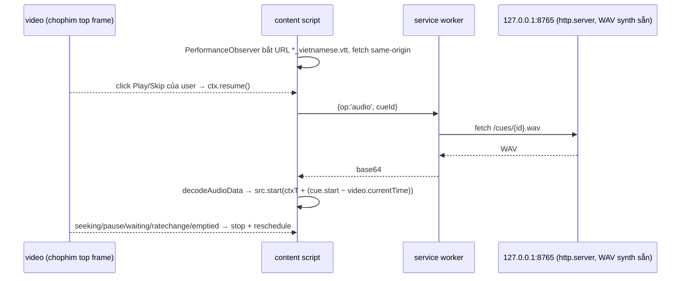

# Phase 0b: Gating spikes G1–G3

## Overview
Ba spike vứt đi, mỗi spike nhắm một giả định [I] còn lại. Pass cả ba thì Phase 1 bắt đầu. Fail thì làm theo cột phản ứng đã quyết sẵn.

## Requirements
- Spike để trong `spikes/` và không phải code sản phẩm. Kết quả đo ghi vào `docs/00-feasibility.md` §6.
- Không vượt qua DRM, auth hay manifest mã hóa. Chỉ dùng `<video>` và VTT công khai.

## Architecture (spike G1)

## Related Code Files
- Create: `spikes/g1-sync/manifest.json`, `spikes/g1-sync/content.js`, `spikes/g1-sync/sw.js`
- Create: `spikes/g2-quality/run.py` (ABX fp32/int8, WSOLA vs `atempo`)
- Create: `spikes/g3-seek/run.py`

## Implementation Steps
1. **G1 Sync spike**
   1. Synth 20 cue đầu tập 1 ra WAV bằng `benchmarks/phase0/bench.py`, serve bằng `python -m http.server 8765 --bind 127.0.0.1`.
   2. Viết MV3 unpacked:
      - `content_scripts` match `https://chophim.lol/xem/*`;
      - `host_permissions: ["http://127.0.0.1/*"]`;
      - không có `webRequest`.
   3. Bật flag `chrome://flags/#local-network-access-check` = Enabled (Blocking).
   4. Log `{cueId, scheduledMediaT, actualMediaT@onset, outputLatency}`. Onset thực tính từ `getOutputTimestamp()` và rVFC.
   5. Chạy các kịch bản: phát thường, pause/resume, seek +10 phút và −2 phút, throttle network (buffering), 1,25× và 1,5×, tab nền, pre-roll, đổi tập, loa trong và AirPods.
2. **G2 Quality**
   1. Chọn 30 cue thật (có SFX, số, tên riêng, nhiều dòng). Synth bằng fp32 và int8 (`onnx_dir` workaround).
   2. Nghe ABX mù fp32 vs int8. Nghe 1,25× bằng WSOLA (`audiotsm`/`pyrubberband`) so với `ffmpeg atempo`.
   3. Đếm số cue đọc sai: không strip, rồi so với normalizer thô (strip `[...]`, `- `, gộp dòng).
3. **G3 Seek storm**
   1. Dùng queue tuần tự + cache theo `hash(text, voice, model_rev)`. Mô phỏng 10 seek ngẫu nhiên trong 48 phút.
   2. Đo thời gian tới audio đầu tiên sau mỗi seek, số lần stall và RSS.

## Success Criteria
- [x] G1: `ctx` = running sau keydown; SW fetch 200, không có prompt LNA; lệch hình–tiếng (rVFC) p50 31 ms, p95 41 ms; vào giữa câu sau seek mất 225–237 ms; 0 cue trong pre-roll; đổi tập sạch. Bluetooth: chưa đo, chuyển sang Phase 1
- [x] G2: < 5% cue hỏng (0/29 theo proxy ASR); chọn `atempo` vì tốt hơn WSOLA. ABX int8 do người nghe: chưa làm, mặc định fp32
- [x] G3: thời gian tới audio đầu tiên p50 0,24–0,40 s, max 0,69 s; 0 stall / 20 seek; RSS đi ngang

## Risk Assessment
| Giả định | Tín hiệu hỏng | Phản ứng định sẵn |
|---|---|---|
| Content script thừa hưởng activation của frame | `ctx.state` vẫn là `suspended` sau click | Chuyển sang offscreen document `AUDIO_PLAYBACK` + keepalive; đồng bộ qua port |
| LNA không áp dụng cho extension SW | SW fetch bị chặn hoặc hiện prompt | **No-Go HTTP**: replan bằng Native Messaging host (stdio) |
| Cùng sink nên latency triệt tiêu | p95 > 200 ms với AirPods | Bù `outputLatency` theo sink + slider offset thủ công |
| int8 không méo trên ARM | Phân biệt được trong ABX | Giữ fp32 |
| Normalizer thô là đủ | > 5% hỏng | Thêm phase normalizer trước Phase 1 |
| Site giữ nguyên cấu trúc | Xuất hiện iframe JW | Adapter `all_frames` (G4, best-effort) |
