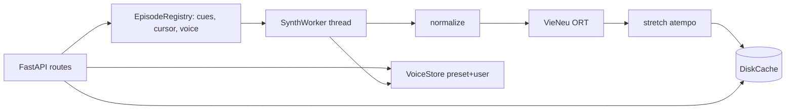

# Phase 1: TTS server local

## Overview
Server FastAPI chạy trên `127.0.0.1:8765`. Nhiệm vụ: nạp VieNeu, quản lý giọng, sinh tiếng tuần tự cho cả tập, căn thời lượng bằng `atempo`, cache ra đĩa. Phase này chạy độc lập, test được bằng `curl` mà không cần extension.

## Requirements
- Làm đúng hợp đồng API trong `plan.md`.
- Một process, một engine ORT fp32 `threads=6`. Có warm-up khi khởi động.
- Một worker sinh tiếng duy nhất (engine có `RLock` nên chạy nhiều luồng cũng không nhanh hơn). Con trỏ bắt đầu từ cue chưa có cache đầu tiên tính từ playhead. Cue có `idx` lớn hơn con trỏ được ưu tiên trước.
- `EpisodeRegistry` chỉ nằm trong RAM. `PUT /episodes/{key}` phải **idempotent**: cùng key + cues + voice thì không reset con trỏ và không sinh lại; khác voice thì sinh lại từ playhead. Cue đã có trên đĩa vẫn được dùng lại sau khi server restart (cache key không phụ thuộc vào episode). `GET` cue/status/playhead với key chưa đăng ký trả `404 {"code":"unknown_episode"}`.
- Cache key = `sha256(textNormalized | voiceId | modelRev | NORM_VERSION | stretchRate)`.
  - Lưu `~/.voxsync/cache/<k[:2]>/<k>.wav`, WAV PCM16 48 kHz mono.
  - Giới hạn mặc định 5 GB, xoá theo mtime (LRU).
  - Phải ghi kèm dung lượng cache cho mỗi giờ thoại vào doc.
- Normalizer (`NORM_VERSION=1`) làm đúng rule đã pass G2: bỏ tag `<..>`, bỏ `[...]`/`(...)`, bỏ `- ` đầu dòng, đổi `…`/`...` thành `, `, gộp các dòng.
- Căn thời lượng: `need = dur / max(nextStart − start, 0.3)`:
  - `need ≤ 1`: giữ nguyên;
  - `need ≤ 1.25`: `ffmpeg -filter:a atempo=need`;
  - `need > 1.25`: `atempo=1.25`, cue chạy dài ra. Độ trễ của mỗi cue = (thời điểm cue *được phát* trước kết thúc) − `start`; khoảng lặng giữa các cue hấp thụ độ trễ. Trả về `X-Delay` cho **chính cue đó**. Cue có độ trễ > 0,5 s thì trả `204` (bỏ nguyên câu, không cắt giữa câu) và không làm lệch timeline phía sau.
- Giọng:
  - 25 giọng preset lấy từ VieNeu;
  - giọng user lưu ở `~/.voxsync/voices.json` (định dạng giống `apps/user_voices.py` của upstream: `speaker_emb` + `codes`);
  - clone qua `tts.add_voice`/encode ref; `consent` phải bằng `true`, nếu không trả 400.
- Bảo mật:
  - chỉ bind `127.0.0.1`;
  - token lưu ở file `0600`, header sai trả 401;
  - giới hạn body (VTT ≤ 2 MB, clip ≤ 10 MB / 15 s);
  - không trả đường dẫn filesystem ra API;
  - không cho tự chọn đường dẫn file.

## Architecture

## Related Code Files
- Create: `server/pyproject.toml` (deps: `vieneu==3.8.4`, `fastapi`, `uvicorn`, `python-multipart`, `soundfile`; dev: `pytest`, `httpx`)
- Create: `server/voxsync_server/{__init__,main,config,auth,normalize,stretch,cache,voices,episodes,worker}.py`
- Create: `server/tests/test_normalize.py`, `test_stretch_policy.py`, `test_cache_key.py`, `test_api.py` (TTS giả qua dependency override; chỉ fake phần engine)
- Create: `server/README.md` (cách chạy, vị trí token, cách tải model)
- Reuse: `spikes/g3-seek/run.py` cho logic con trỏ; `benchmarks/phase0/bench.py`

## Implementation Steps
1. `uv init` trong `server/`, pin `vieneu==3.8.4` + revision model HF. Snapshot model về `~/.voxsync/models` qua `snapshot_download(local_dir=…)` để tránh bug symlink external-data của ORT.
2. `config.py`: đường dẫn, port, giới hạn. `auth.py`: tạo và kiểm tra token.
3. `normalize.py` + test lấy ca thật từ VTT tập 1 (SFX, `- `, nhiều dòng, `…`).
4. `stretch.py`: hàm thuần `decide_rate`, `delay_after`, `should_drop`, có test biên; wrapper gọi `ffmpeg atempo`.
5. `cache.py`: tính key, ghi kiểu atomic (tmp rồi rename), xoá LRU, `bytes()`.
6. `voices.py`: preset + user, clone, đổi tên, xoá, preview (giữ cache preview trong RAM).
7. `episodes.py`: registry + worker (đăng ký tập, `playhead`, con trỏ quay vòng, timeline `_retime`, trạng thái `202/204/410`, đổi giọng thì sinh lại từ playhead).
8. `main.py`: các route, khởi động (load + warm-up), shutdown sạch.
9. `/health` trả thêm RTF trung bình của 20 cue gần nhất.

## Success Criteria
- [x] `uv run pytest` xanh (40 test). Mutation check xác nhận test bắt được các lỗi: drop/delay sai, PUT không idempotent, spin khi file hỏng, `_retime` dừng sớm khi cache có khoảng trống.
- [x] Smoke engine thật: PUT tập 1 (716 cue), playhead `t=600` → cue 121 trả 200 sau **0,66 s**; `rtf` sau 60 s là **0,107**.
- [x] Cả tập 1 xong trong **204,5 s**. Cache ≈ **346 MB/giờ lời thoại**, đã ghi trong `server/README.md` và `docs/01-tts-poc.md`.
- [x] Clone clip 2,5 s: có trong `/voices`, preview là WAV, còn sau restart; lúc clone `/health` vẫn trả ≤ 4 ms.
- [x] Không token → 401 (trước khi đọc body, kể cả chunked); IP LAN → connection refused; chỉ listen `127.0.0.1`.
- [x] Restart: re-PUT dùng lại cache đĩa, kể cả cache rời rạc sau khi mới xem một phần (20 cue liên tiếp trả 200 trong 31 ms).

Không làm trong phase này: phát tạm audio giọng cũ trong lúc chờ giọng mới (rủi ro 3 bên dưới). Đổi giọng hiện tạo khoảng trống `202` ngắn. Phase 3 đo khoảng trống này theo tiêu chí "không trống tiếng quá 2 s".

## Risk Assessment
| Rủi ro | Dấu hiệu | Phản ứng |
|---|---|---|
| API `add_voice` của upstream đổi | Clone ném lỗi | Pin version; dùng `_resolve_ref(ref_audio)` để lấy emb/codes rồi tự lưu |
| `atempo` làm méo tiếng ngắn < 0,4 s | CER của cue ngắn tăng | Không stretch cue < 0,4 s, cho tràn |
| Đổi giọng giữa phim gây trống tiếng | Cue `202` kéo dài | Giữ audio giọng cũ trong cache, phát tạm cho tới khi giọng mới kịp |
