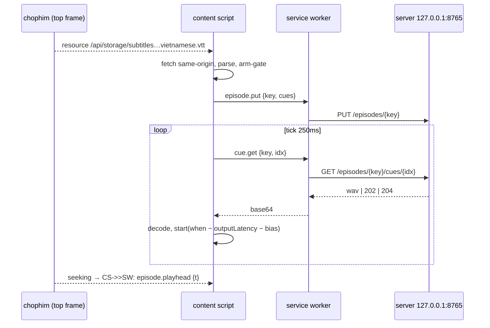

# Phase 2: Extension core

## Overview
Extension MV3 cho `chophim.lol`:
- tự nhận phụ đề tiếng Việt (F2);
- gửi phụ đề lên server;
- lập lịch phát tiếng lồng theo `video.currentTime`;
- giảm âm gốc khi có thoại;
- chặn lồng tiếng lên quảng cáo.

Viết lại từ spike `spikes/g1-sync` thành code sản phẩm, gồm cả các fix đã tìm ra trong review và bù độ trễ dư +14 ms.

## Requirements
- **Nhận phụ đề (F2):**
  - `PerformanceObserver({type:'resource', buffered:true})` lọc `/api/storage/subtitles?file=`;
  - phân loại ngôn ngữ: token trong tên file (`vietnamese|vie|vi|viet`), nếu không có token thì dùng tỷ lệ ký tự có dấu Việt trong 20 cue đầu ≥ 0,3;
  - lấy tập từ `tap-(\d+)`, hoặc lấy `"movie"` nếu là phim lẻ;
  - fetch lại same-origin, parse VTT (CRLF, nhiều dòng, cue rỗng, cue trùng);
  - bỏ qua phụ đề ngôn ngữ khác và VTT thumbnail (`/api/storage/webvtt`).
- **Không có VTT tiếng Việt** sau `loadedmetadata` + 10 s: trạng thái `no-subtitle`, kèm lý do (vd. server KK/Thuyết Minh).
- **Arm-gate:** chỉ bật khi `duration > 300` **và** VTT tiếng Việt được bắt sau `emptied` gần nhất. Tắt khi gặp `emptied`.
- **Scheduler:**
  - lookahead 3 s, prefetch 25 s;
  - `when = ctxT + (cue.start − mediaT)/rate − ctx.outputLatency − bias`;
  - `bias` là setting (mặc định đo ở bước 6) cộng `userOffsetMs`;
  - vào giữa câu (late-join) thì dùng `start(when, offset)`;
  - reschedule khi gặp `seeking/waiting/pause/playing/seeked/ratechange/emptied`;
  - kiểm drift mỗi tick, resync nếu > 80 ms;
  - không dùng `setTimeout` để phát.
- **Cue `202`:** thử lại sau `X-Retry-Ms` (backoff tối đa 2 s). **Cue `204`:** im lặng, bỏ qua. **Cue `410`:** bỏ qua và ghi log. **`X-Delay`:** phát cue tại `cue.start + X-Delay`, chỉ đọc từ response của chính cue đó (không tự cộng dồn). **`404 unknown_episode`:** re-put; **`404 unknown_cue`:** bỏ qua.
- **Ducking:** dựa trên các source đang thực sự kêu (lead 100 ms, hold 300 ms), ramp 5 bước trong 50 ms. Theo dõi user đổi volume bằng cách so với giá trị extension ghi gần nhất (`volumechange` chạy async).
- **AudioContext:** tạo và `resume()` ở `pointerdown/keydown` capture, hoặc ở `play`. Nếu vẫn `suspended`, overlay nhỏ hiện "Bấm để bật lồng tiếng".
- **Bộ nhớ:** chỉ giữ buffer đã decode trong cửa sổ [playhead − 30 s, playhead + 60 s]. Phần còn lại lấy lại từ server (cache trên đĩa).
- **Nối lại server:** khi chuyển `server-offline → online`, hoặc nhận `404 unknown_episode` cho key đang dùng, content script gửi lại `episode.put` (cues + voice) rồi `episode.playhead`, sau đó mới lấy cue tiếp. Server restart vẫn dùng được cache đĩa nên không phải sinh lại.
- **SW proxy:**
  - op cố định, validate input;
  - đính token;
  - `PUT episode` khi có VTT mới, `playhead` khi seek;
  - trả audio dạng base64;
  - không bao giờ fetch URL do caller đưa vào.
- **Chế độ debug:** bật trong settings thì ghi metric rVFC (A/V signed/abs, drift) và export JSON. Đây là thước đo chính thức, giữ lại từ spike.

## Architecture

## Related Code Files
- Create: `extension/package.json` (dev deps: `typescript`, `esbuild`, `vitest`, `@types/chrome`), `extension/tsconfig.json`, `extension/build.mjs`
- Create: `extension/manifest.json`, `extension/src/sw/{index,proxy,settings}.ts`
- Create: `extension/src/content/{index,subtitle-detect,vtt,arm,scheduler,ducking,metrics}.ts`, `extension/src/shared/{messages,types}.ts`
- Create: `extension/test/{vtt,subtitle-detect,scheduler-math,arm}.test.ts`
- Reference (không sửa): `spikes/g1-sync/*`

## Implementation Steps
1. Khung dự án: esbuild bundle `sw.js`, `content.js`, copy `manifest.json` vào `extension/dist/`.
2. `vtt.ts` (hàm thuần) + test: CRLF, nhiều dòng, timestamp `mm:ss.mmm`, cue rỗng, cue trùng, chồng thời gian.
3. `subtitle-detect.ts`: phân loại ngôn ngữ + key tập + test bằng 5 tên file thật đã thu ở Phase 0 (`tap_01_vietnamese`, `the_odyssey_vie`, `_korean`, `_chinese_simplified`, `webvtt?file=`).
4. `arm.ts` (state machine thuần) + test: pre-roll 62 s, `emptied`, VTT tới trước/sau `emptied`, đổi tập.
5. `scheduler.ts`: tách hàm thuần `computeWhen()`/`lateJoin()`/`driftOf()` để test; phần còn lại gắn với AudioContext.
6. **Hiệu chỉnh độ trễ:**
   1. chạy debug mode trên chophim với loa trong;
   2. đặt `bias` mặc định bằng −(signed mean đo được);
   3. đo lại tới khi |signed mean| ≤ 5 ms.
7. `ducking.ts`, `sw/proxy.ts` (fix theo review: ghép `ep` sau `await decode`, backoff, giới hạn bộ nhớ).
8. Smoke E2E trên Chrome for Testing (`--load-extension`, phím Shift làm gesture, **không click vào vùng video**) theo kịch bản G1. Lưu dump vào `docs/phase0-evidence/` → `docs/02-browser-integration.md`.

## Success Criteria
- [x] `npm test` xanh (48). Test bắt được: chọn nhầm VTT tiếng Anh, arm trong pre-roll, `when` sai khi rate 1,5, late-join offset sai.
- [x] E2E chophim tập 1 tự có tiếng lồng sau **một click lên tiêu đề phim**. Phím Shift không đủ: player không autoplay ở profile mới.
- [x] rVFC (loa trong): signed mean **−2,9 ms**, p95 cue-start **36 ms**, p95 late-join **63 ms**.
- [x] Seek ±, pause/resume ×3, rate 1,25/1,5, đổi tập 1→2, tab nền 40 s: không phát sai câu, không rò tiếng tập cũ.
- [x] Ducking chỉ bật khi có thoại; đổi volume tay sang 0,6 thì lúc có thoại còn 0,18.
- [x] Server KK: `no-subtitle` sau 11 s, không giảm âm; quay lại Song Ngữ thì armed sau 1 s.
- [x] Server tắt giữa chừng: `server-offline`, im lặng, volume trả về 1. Server lên lại: **tiếng lồng phát sau 2,5 s**.

## Risk Assessment
| Rủi ro | Dấu hiệu | Phản ứng |
|---|---|---|
| chophim đổi path API phụ đề | Không bắt được VTT | Đã có fallback dán URL/tải file (Phase 3); cập nhật regex trong adapter |
| `outputLatency` thay đổi khi đổi thiết bị | signed mean nhảy | Đọc `outputLatency` mỗi tick, không cache |
| SW bị suspend giữa chừng | `cue.get` lỗi kênh | Content script retry; SW không giữ state quan trọng (state ở content script + server) |
