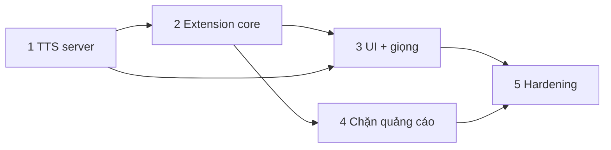

# VieNeu Live Dubbing — MVP (chỉ chophim.lol)

## Overview
Bản dùng được hằng ngày trên `chophim.lol`, server "Song Ngữ". Mọi quyết định kỹ thuật dựa trên Phase 0 (`plans/261111-0703-vieneu-live-dubbing-phase0`, `docs/00-feasibility.md`): số đo thật, không giả định.

## Quyết định đã chốt (từ Phase 0)
| Hạng mục | Quyết định |
|---|---|
| TTS | `vieneu==3.8.4`, v3 Turbo, ORT CPU fp32 `threads=6`, 1 process, pin model revision |
| Sinh tiếng | Sinh tuần tự cả tập, bắt đầu từ playhead; khi seek thì dời con trỏ; cache theo cue. Không streaming, không WebSocket |
| Căn thời lượng | Tính ở server lúc synth: `need = dur / (nextStart − start)`; nếu ≤ 1,25 thì dùng `ffmpeg atempo`; nếu > 1,25 thì cho tràn, cue sau trễ tối đa 0,5 s, quá nữa thì bỏ cue sau |
| Chuẩn hoá text | Chỉ làm ở **server** (một nơi duy nhất); extension gửi text thô |
| Đồng bộ | Đồng hồ chuẩn là `video.currentTime`; phát bằng `AudioBufferSourceNode.start(when − outputLatency − bias)`; reschedule khi `seeking/waiting/pause/ratechange/emptied` |
| Gọi localhost | Service worker làm proxy, op cố định, `host_permissions: http://127.0.0.1/*`, có token |
| Phụ đề | `PerformanceObserver` bắt `/api/storage/subtitles`, phân loại ngôn ngữ, ghép tập |
| Giảm âm gốc | `video.volume = userVol × duck`, ramp 50 ms, chỉ duck khi có tiếng lồng đang phát |
| Chặn quảng cáo | `declarativeNetRequest` + CSS, **tắt mặc định** |
| Extension | TypeScript + esbuild, HTML/TS thuần (không React) |

## Cấu trúc repo
```
VoxSync/
├── server/      # Python (uv), FastAPI: TTS, cache, giọng
├── extension/   # MV3: sw, content, popup, options, rules
├── docs/  benchmarks/  plans/
```
Bỏ cấu trúc monorepo `packages/*` trong brief: MVP chỉ có 2 app; package dùng chung là YAGNI.

## Phases
| # | Phase | Phụ thuộc | Có thể chạy song song | Status |
|---|---|---|---|---|
| 1 | [TTS server local](./phase-01-tts-server.md) | — | — | Completed |
| 2 | [Extension core: phụ đề + đồng bộ + ducking](./phase-02-extension-core.md) | 1 | — | Completed |
| 3 | [Popup + quản lý giọng (F1)](./phase-03-ui-voice-manager.md) | 1, 2 | với 4 | Completed |
| 4 | [Chặn quảng cáo (F3)](./phase-04-ad-blocking.md) | 2 | với 3 | Completed |
| 5 | [Hardening + Bluetooth + phát hành nội bộ](./phase-05-hardening-release.md) | 1–4 | — | Pending |



## Hợp đồng API (server ↔ service worker)
Server bind `127.0.0.1:8765`. Mọi request phải có header `X-VoxSync-Token` (token sinh ở lần chạy đầu, lưu `~/.voxsync/token`). Không bật CORS.

| Method | Path | Body / trả về |
|---|---|---|
| GET | `/health` | `{ok, model, revision, backend, voices, defaultVoice, cacheBytes, episodes, rtf}` |
| GET | `/voices` | `{default, voices: [{id, name, gender, region, style, kind: "preset"\|"user"}]}` |
| POST | `/voices` | multipart `{name, consent=true, gender?, clip (wav/mp3/flac, 2–15 s, ≤ 10 MB)}` → `201` voice. `400 consent_required / clip_duration / unsupported_audio` |
| PATCH | `/voices/{id}` | `{name}` (chỉ giọng user) |
| DELETE | `/voices/{id}` | chỉ giọng user |
| POST | `/voices/{id}/preview` | `{text?}` → `audio/wav` |
| PUT | `/episodes/{key}` | `{voice, cues: [{idx, start, end, text}]}` → `{cues: n}`. `key = sha1(vttUrl)` |
| POST | `/episodes/{key}/playhead` | `{t}` → dời con trỏ sinh tiếng |
| GET | `/episodes/{key}/cues/{idx}` | `200 audio/wav` + `X-Stretch`, `X-Delay` (**độ trễ của chính cue này, đơn vị giây: phát tại `start + X-Delay`**); `202` đang sinh (`X-Retry-Ms`); `204` im lặng (`X-Reason: dropped\|empty`); `404 {code: unknown_episode\|unknown_cue}`; `410 synth_failed` |
| GET | `/episodes/{key}/status` | `{total, ready, readyAhead, cursorIdx, voice, playhead, rtf}` |

Mọi lỗi trả về JSON `{code, …}`. `422 invalid_request` không echo lại input. Token sai hoặc thiếu trả `401` **trước khi đọc body**. Body vượt giới hạn trả `413` (kể cả khi gửi chunked). `PUT /episodes/{key}` là idempotent: cùng cue và giọng thì không làm gì.

Message giữa content script và SW là JSON. Audio đi dưới dạng base64. Danh sách op cố định: `health, voices.*, episode.put, episode.playhead, cue.get, settings.*`.

## Ngoài phạm vi MVP
- **Các trang khác.** Khi làm, detector generic phải:
  - đặt `track.mode = "hidden"` trước khi đọc cue (track `disabled` sẽ trả `cues` rỗng), và chỉ đọc sau sự kiện `load`;
  - với HLS qua hls.js/shaka thì cue đã có sẵn trong `textTracks`, chỉ trường hợp MSE thô mới phải tự ghép segment.
- Nhiều giọng theo nhân vật, tách lời thoại khỏi nhạc nền, phụ đề in cứng (OCR), streaming TTS.

## Success Criteria (MVP)
- [ ] Mở một tập bất kỳ trên server Song Ngữ: tự nhận VTT tiếng Việt và có tiếng lồng trong ≤ 3 s sau khi phim bắt đầu (không tính quảng cáo)
- [ ] Lệch hình–tiếng (rVFC) trên loa trong: |signed mean| ≤ 5 ms, p95 ≤ 60 ms; trên AirPods sau khi bù: p95 ≤ 120 ms
- [ ] Seek, pause, đổi tốc độ 1–1,5×, đổi tập, chạy tab nền: không phát sai câu, không rò tiếng tập cũ
- [ ] Đổi giọng hoặc clone giọng ngay trong UI; nghe thử < 2 s
- [ ] Bật chặn quảng cáo: không còn pre-roll, player không lỗi; tắt chặn: không lồng tiếng lên quảng cáo
- [ ] Chạy 45 phút liên tục: 0 stall với thoại dày, RSS server ổn định
